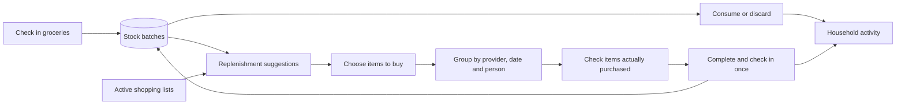

# Hearth: household inventory and coordinated shopping

Hearth keeps one shared view of what is at home, what was used or discarded,
and what a household intends to buy. Its first version has a dedicated SQLite
database and no account setup. Names select who is acting; they are not authenticated
identities. Product, category, location, provider, and member IDs are generated
internally, so nobody has to maintain IDs.

## Research and design decisions

Official project sources were reviewed on 11 October 2026. Grocy's stock service
demonstrates separate stock entries with quantities, locations and best-before
dates, logged purchase/consumption/correction operations, underflow checks, and
missing-product shopping suggestions. Mealie's feature documentation demonstrates
checkable shopping items, labels that can represent stores, calendar planning,
reusable food/unit data, and household-scoped lists. These are useful mature
patterns; the choices below are Hearth's implementation, not a claim that the
source systems behave identically.

| Pattern                        | Hearth's household adaptation                                                                                                                   |
| ------------------------------ | ----------------------------------------------------------------------------------------------------------------------------------------------- |
| Batch-level stock              | A product can have several quantities in different locations with different expiry dates. Product totals are calculated from batches.           |
| First expiry, first out (FEFO) | Consumption uses dated batches in expiry order, then undated batches; older additions break ties. A person can select the actual batch instead. |
| Recorded stock movements       | Check-ins, purchases, consumption, waste and corrections create an activity trail. Insufficient stock fails before any batch changes.           |
| Explicit replenishment         | A minimum quantity produces a suggestion. The person chooses which suggestions become committed shopping items.                                 |
| Avoid duplicate purchasing     | Quantities already on active lists reduce further suggestions, including checked items until they are checked into stock.                       |
| Store-oriented execution       | A single list can include REWE, PENNY, the market and custom providers. Items are grouped by provider, so one trip can have several stops.      |
| Shared planning                | Each list can have a date and an assigned household member; people can claim a trip themselves.                                                 |
| Reusable master data           | Categories describe products, locations describe stock, and preferred providers are starting defaults that can be overridden per shopping item. |

The replenishment rule, in the product's own unit, is:

```text
Only when stock <= minimum:
suggestion = max(0, max(minimum - stock, 1) - quantity on active lists)
```

The one-unit floor makes a product at its threshold actionable. Quantities support
six decimal places; units are labels rather than an automatic conversion system.
For example, the app does not convert a litre into a carton without a person
choosing a consistent unit.

## Main workflows

1. Define locations, categories, providers and optional household members.
2. Register a product, its unit, minimum stock and preferred provider.
3. Check in a quantity to its real location, with an optional expiry date.
4. Record consumption or waste when it happens. Use batch corrections to reconcile
   a physical stock count or change a location/date.
5. Select replenishment suggestions or add shopping items manually. Adjust each
   store, schedule the list, and assign the trip.
6. Check purchased items while shopping. Completing the list adds checked items
   to the chosen home location exactly once. Unchecked entries remain visible
   in the completed list for explicit follow-up; completion does not purchase them.



## Data and reliability

The React interface calls an Express API; SQLite holds household metadata,
products, batches, lists, list items and activity. Foreign keys protect references.
Related inventory changes and their activity records use database transactions.
Shopping items have an internal transfer marker and completed lists reject a
second completion, preventing a repeated request from duplicating stock.

The default database lives in `data/household.sqlite`; set `GROCERY_DB_PATH` to
choose persistent storage. `GET /api/export` produces a data export. For an exact
database backup, stop the server before copying the SQLite database, or use a
SQLite-aware online backup procedure. Preserve the database across container
replacement. Tests create independent temporary databases.

Member profiles and list assignments prepare the workflow for a partner. Adding
a profile shares the same household data immediately. Authentication, invitations,
access control and multiple isolated households require a separate future change;
the current app belongs on a trusted private network or behind authenticated
access.

## Current boundaries and next useful improvements

- Inventory changes and expiry dates are entered manually. There is no receipt
  parsing, camera/barcode lookup, retailer ordering, or automatic food recognition.
- Scheduling records a calendar date. It does not send reminders or calculate
  travel routes, retailer opening hours, prices, or availability.
- Completing a shopping list uses one selected location and optional expiry date
  for that check-in. Use batch corrections afterward for mixed storage or dates.
- Unchecked items on completed lists are not included in active replenishment
  reservations. Re-add them deliberately to a new trip if they are still needed.
- The API serializes inventory mutations in SQLite. The interface refreshes after
  actions; it does not provide live push updates or offline synchronization.
- JSON export is for portability; an import/recovery interface and a scheduled
  backup job are useful next additions before long-term household use.
- A consumption-based reorder forecast should come after enough real movement
  history exists. The first version uses a transparent minimum rather than an
  uncalibrated prediction.

## Reviewed sources

- [Grocy stock service, pinned official source](https://raw.githubusercontent.com/grocy/grocy/41206cb90154e0d17d3e108cc1f182b94fdb465d/services/StockService.php):
  `AddProduct`, `ConsumeProduct`, `EditStockEntry` and
  `AddMissingProductsToShoppingList` were reviewed.
- [Grocy project overview](https://raw.githubusercontent.com/grocy/grocy/master/README.md):
  API-based interface, self-hosted household management and optional barcode/PWA
  features provide context for future expansion.
- [Mealie feature documentation, pinned official source](https://raw.githubusercontent.com/mealie-recipes/mealie/0931f4efc9cbfc446b8f0307abd0b66cec7c81c2/docs/docs/documentation/getting-started/features.md):
  Shopping Lists, Meal Planning, Data Management, Groups and Households, and
  Backups were reviewed.

All cited raw-document URLs were fetched successfully with TLS verification.
The hosted `grocy.info` and `docs.mealie.io` websites returned proxy HTTP 403 in
this environment; their official source documentation remained accessible.
